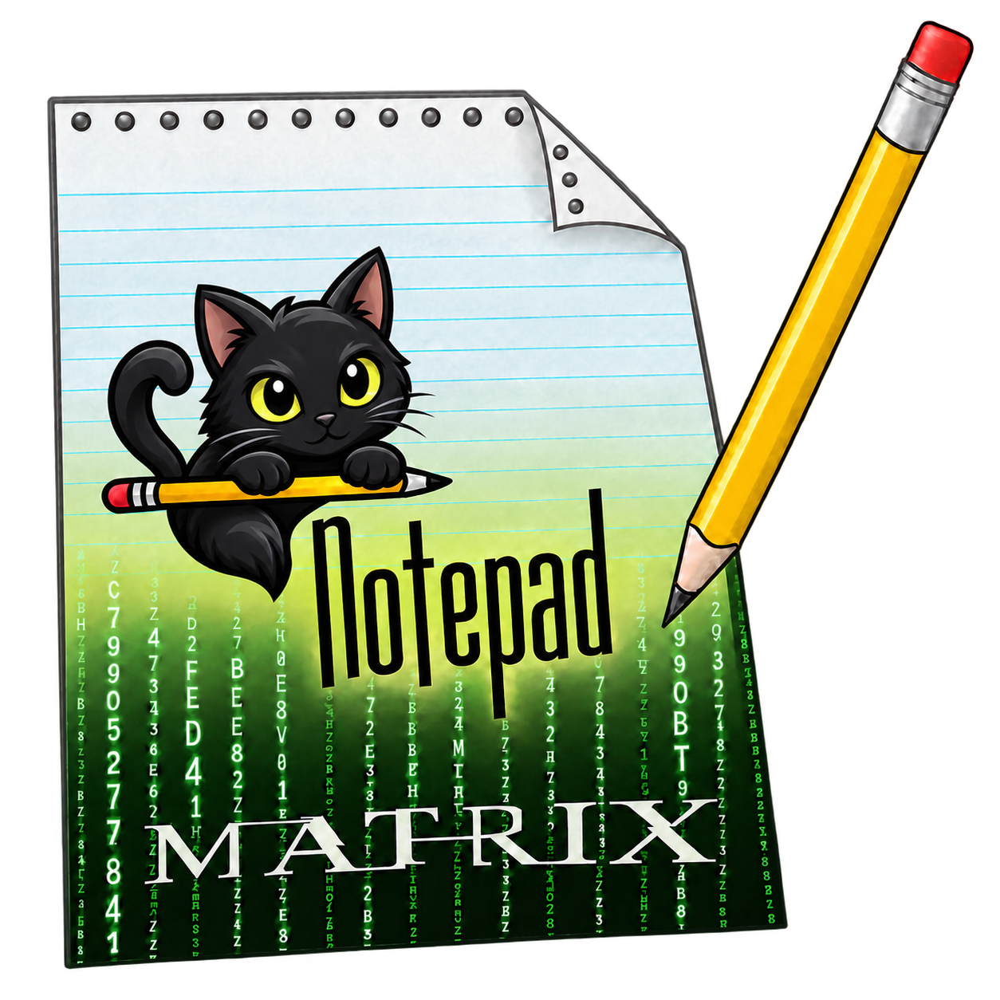

<p align="center">
  
</p>

<h1 align="center">Notepad Matrix</h1>

<p align="center">
  <a href="README_zh.md">中文</a> ·
  <a href="BUILD.md">Build guide</a> ·
  <a href="DESIGN.md">Design decisions</a>
</p>

A free, open-source text editor for macOS, built with Rust and GPUI.

Project: [github.com/skyfiredao/notepad-matrix](https://github.com/skyfiredao/notepad-matrix)

## Quick start

On an Apple Silicon Mac running macOS 26, install the prerequisites in [BUILD.md](BUILD.md), then run these commands from the directory containing `Cargo.toml`:

```sh
export MACOSX_DEPLOYMENT_TARGET=26.0
cargo build --locked --release --target aarch64-apple-darwin
./target/aarch64-apple-darwin/release/notepad-matrix ./notes.txt
```

To create a Finder-launchable application and disk image, follow the [packaging instructions](BUILD.md#4-package-the-application).

For downloaded or ad-hoc-signed builds, see [macOS launch approval](BUILD.md#5-allow-a-trusted-application-to-run).

## Project background

Notepad Matrix brings Notepad++ editing habits to macOS. It is an independent project, not an official Notepad++ release.

## Features

- Tabbed documents, two editor views, multiple selections, rectangular selections, undo and redo.
- Find and replace, regular expressions, search in files, and result navigation.
- Syntax highlighting, folding, user-defined languages, completion, call tips, and a function list.
- UTF-8 by default, UTF-16 BOM formats, and explicit Windows, OEM, and other character sets.
- Session recovery with periodic document backups stored separately from JSON metadata.
- Document list and document map panels, with docking and floating windows.
- Macros, configurable shortcuts, saved Run commands, and document variables.
- MD5, SHA-1, SHA-256, SHA-512, Converter, MIME Tools, and HTML file export.
- Read-only Markdown preview, including Mermaid diagrams.
- macOS file dialogs, printing, Finder integration, and native input handling.

The Plugins menu contains built-in modules. See [platform boundaries](DESIGN.md#goals-and-boundaries).

## Matrix Easter egg and screen lock

Use the **F1** shortcut, **? → About**, or the toolbar's green circled **i** to open the Easter egg. Select **Matrix** (default) or **Simulated terminal** in **Preferences → General → Style**. The terminal does not run real commands.

**In-app locking is off by default.** Enable it in **Preferences → General → Matrix screen lock**. With it off, closing About returns to the document. With it on, opening the Easter egg locks the application; About closes after a seven-second countdown, but the application stays locked. Click the animation and complete macOS system authentication to unlock.

The application lock does not replace the macOS screen lock or encrypt files.

See [design details](DESIGN.md#8-keep-matrix-animation-separate-from-document-contents).

## Command-line usage

```sh
./target/aarch64-apple-darwin/release/notepad-matrix -multiInst -nosession ./notes.txt
./target/aarch64-apple-darwin/release/notepad-matrix -lrust -n20 -c5 ./src/main.rs
./target/aarch64-apple-darwin/release/notepad-matrix -- ./-example.txt
```

| Option | Purpose |
|---|---|
| `--version` | Print the build version and exit without opening a window. |
| `-multiInst` | Start an independent instance. |
| `-nosession` | Do not restore or save the automatic session for this launch. |
| `-openSession session.json` | Open one saved session file. |
| `-l<language>` | Select a built-in language, such as `rust`. |
| `-udl=<name>` | Select an installed user-defined language. Quote names containing spaces. |
| `-n<line>` / `-c<column>` | Set the initial position, starting at 1. |
| `--` | Treat all following arguments as file paths. |

Build versions use `0.3.N+<SHA7>`. `N` counts commits affecting `notepad-matrix/` since the current major/minor series began. Rebuilding the same commit does not increment it.

## Configuration

Settings and user data live in `~/.notepad-matrix/`.

| File or directory | Purpose |
|---|---|
| `settings.json` | Preferences and built-in module switches. |
| `macros.json` | Recorded macro actions. |
| `shortcuts.xml` | Shortcut overrides, including macro bindings matched by name, and saved Run commands. |
| `converter.ini` | Converter formatting options. |
| `backup/` | Automatic session metadata and independent document backup files. |

Close the application before editing configuration files manually. Run commands can start external programs. See [recovery behavior](DESIGN.md#4-separate-document-backups-from-session-metadata).

## Development

Report issues in the [project repository](https://github.com/skyfiredao/notepad-matrix) with the macOS version, chip architecture, build revision, and steps to reproduce.

## License

Notepad Matrix is licensed under [GNU GPL v3](LICENSE). [Third-party notices](THIRD_PARTY_NOTICES.md) group shared license terms and retain component copyright notices.
