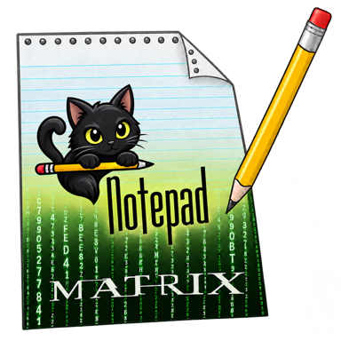

<p align="center">
  
</p>

<h1 align="center">Notepad Matrix</h1>

<p align="center">
  <a href="README.md">English</a> ·
  <a href="BUILD_zh.md">构建说明</a> ·
  <a href="DESIGN_zh.md">设计取舍</a>
</p>

使用 Rust 和 GPUI 构建的免费、开源 macOS 文本编辑器。

项目地址：[github.com/skyfiredao/notepad-matrix](https://github.com/skyfiredao/notepad-matrix)

## 快速开始

以运行 macOS 26 的 Apple Silicon Mac 为例，按 [BUILD_zh.md](BUILD_zh.md) 安装构建环境，然后在包含 `Cargo.toml` 的项目目录运行：

```sh
export MACOSX_DEPLOYMENT_TARGET=26.0
cargo build --locked --release --target aarch64-apple-darwin
./target/aarch64-apple-darwin/release/notepad-matrix ./notes.txt
```

需要可从 Finder 启动的应用和磁盘映像时，按[应用打包步骤](BUILD_zh.md#4-应用打包)生成 `.app` 和 `.dmg`。

下载版本或临时签名包被系统阻止时，参见 [macOS 单应用运行授权](BUILD_zh.md#5-允许运行可信应用)。只从官方项目或可核验的可信发布者下载，核对发布方提供的校验值后再决定是否允许运行。

## 项目缘起

项目起于使用者对免费 macOS 编辑器的需求，也希望保留在 Notepad++ 中养成的编辑习惯。目标是在 macOS 上完成日常文本和源码编辑。Notepad Matrix 是独立项目，并非 Notepad++ 官方版本。

## 功能

- 多标签文档、双编辑视图、多选区、矩形选区、撤销和重做。
- 查找替换、正则表达式、文件搜索和结果定位。
- 语法高亮、折叠、自定义语言、自动补全、参数提示和函数列表。
- 默认 UTF-8、带 BOM 的 UTF-16 格式，以及显式 Windows、OEM 等字符集。
- 会话恢复和定时备份，正文文件与 JSON 元数据分开保存。
- 文档列表、文档结构图，以及面板停靠和浮动窗口。
- 宏、自定义快捷键、保存的运行命令和当前文档变量。
- MD5、SHA-1、SHA-256、SHA-512、Converter、MIME Tools 和 HTML 文件导出。
- 只读 Markdown 预览，支持 Mermaid 图表。
- macOS 文件选择、打印、Finder 集成和原生输入处理。

“插件”菜单提供固定内嵌模块，不提供 DLL 加载或插件市场。Windows 默认 ACP、Windows 更新器和 Intel／Universal 打包不在当前实现范围内。

## Matrix 彩蛋与锁屏保护

使用快捷键 **F1**、菜单 **? → 关于**或工具栏绿色圆圈 **i** 打开彩蛋。在**首选项 → 常用 → 样式**中选择 **Matrix**（默认）或**伪终端**。伪终端不执行真实命令。

**应用内锁屏默认关闭**，可在**首选项 → 常用 → Matrix 锁屏保护**中启用。未启用时，关闭关于即可返回文档；启用后，打开彩蛋会锁定应用，关于窗口在七秒倒计时后关闭，应用仍保持锁定。点击动画并通过 macOS 系统认证即可解锁。

应用锁定不替代 macOS 系统锁屏，也不加密文件。

详见[设计说明](DESIGN_zh.md#8-matrix-动画与正文分开)。

## 命令行用法

```sh
./target/aarch64-apple-darwin/release/notepad-matrix -multiInst -nosession ./notes.txt
./target/aarch64-apple-darwin/release/notepad-matrix -lrust -n20 -c5 ./src/main.rs
./target/aarch64-apple-darwin/release/notepad-matrix -- ./-example.txt
```

| 参数 | 用途 |
|---|---|
| `-multiInst` | 启动独立实例。 |
| `-nosession` | 本次启动不恢复或保存自动会话。 |
| `-openSession session.json` | 打开一份已保存的会话文件。 |
| `-l<language>` | 选择内建语言，例如 `rust`。 |
| `-udl=<name>` | 选择已安装的自定义语言，名称含空格时加引号。 |
| `-n<line>`／`-c<column>` | 设置初始行列，从 1 开始。 |
| `--` | 后续参数全部按文件路径处理。 |

不支持的参数会报错，命令行兼容不涵盖 Notepad++ 的全部选项。

## 配置

配置和用户数据位于 `~/.notepad-matrix/`。日常修改使用应用内设置和快捷键管理窗口。

菜单字体和字号在**设置 → 首选项 → 常用**的界面语言旁调整。默认“苹方-简（PingFang SC）14”，支持 8–24 号，即时生效，与编辑区及对话框字体独立。

| 文件或目录 | 用途 |
|---|---|
| `settings.json` | 首选项和内嵌模块开关。 |
| `macros.json` | 录制的宏动作。 |
| `shortcuts.xml` | 快捷键覆盖、按名称匹配的宏绑定，以及保存的运行命令。 |
| `converter.ini` | Converter 格式选项。 |
| `backup/` | 自动会话元数据和独立正文备份。 |

手工修改配置前先退出应用。恢复备份不等于正式保存，也不能替代重要文件的独立备份。运行命令可以启动外部程序，执行前先检查命令内容。

## 开发

[BUILD_zh.md](BUILD_zh.md) 说明通用 macOS 环境配置、本机运行、打包和构建故障处理。[DESIGN_zh.md](DESIGN_zh.md) 说明字节编辑模型、平台边界、恢复格式和资源取舍。

通过[项目仓库](https://github.com/skyfiredao/notepad-matrix)提交改动或问题。问题报告请附 macOS 版本、芯片架构、构建版本和复现步骤，不附带私人文档或配置密钥。

## 许可

Notepad Matrix 基于 [GNU GPL v3](LICENSE) 发布。[第三方声明](THIRD_PARTY_NOTICES.md) 合并共同许可条款，保留各组件的版权声明。**关于 → 许可证与第三方声明**打开公开发布仓库的许可章节。

应用包附带这两份法律文件。源码和构建脚本保留在本仓库中。二进制下载页面须注明对应源码的标签或修订版本。
